# 🌦️ WeatherOps Dashboard – CI/CD Pipeline & Deployment
**TYCSE – Cloud Computing & DevOps (CCA 2 Project)**  
**Total Marks:** 10 | **Target:** 10/10 Full Rubric Fulfillment  

An end-to-end automated Continuous Integration and Continuous Deployment (CI/CD) pipeline built with **Jenkins**, **Docker**, **Kubernetes (Minikube)**, and **AWS EC2**, deploying a full-featured, modern **Python/Flask Weather Dashboard application**.

---

## 📌 Table of Contents
1. [Project Overview](#1-project-overview)
2. [Architecture & Workflow](#2-architecture--workflow)
3. [Repository File Structure](#3-repository-file-structure)
4. [CI/CD Pipeline Stages (Jenkinsfile)](#4-cicd-pipeline-stages-jenkinsfile)
5. [AWS EC2 & Jenkins Setup](#5-aws-ec2--jenkins-setup)
6. [Containerization (Dockerfile)](#6-containerization-dockerfile)
7. [Container Registry Integration (Docker Hub / AWS ECR)](#7-container-registry-integration)
8. [Kubernetes Orchestration on Minikube](#8-kubernetes-orchestration-on-minikube)
9. [Application Verification & Access](#9-application-verification--access)
10. [Step 9: Demonstrating Code Change & Redeployment](#10-step-9-demonstrating-code-change--redeployment)
11. [Evaluation Rubric & Viva Voce Q&A](#11-evaluation-rubric--viva-voce-qa)

---

## 1. Project Overview

The **WeatherOps Dashboard** is an academic software project developed using **Python 3** and **Flask**. It delivers live global meteorological telemetry (temperature, feels-like, wind speed, humidity, atmospheric pressure, UV index, and 5-day forecasts) via real-time satellite data with zero external API key requirements and robust offline fallbacks.

### Key Application Features:
- **Clean Solid Design:** Styled strictly with solid, high-contrast, modern engineering colors (no CSS gradients).
- **Asynchronous Search:** Instant search for global cities (Pune, Mumbai, London, New York, Tokyo, etc.) with quick-chip selectors.
- **Unit Conversions:** Dynamic switching between Metric (°C, km/h) and Imperial (°F, mph).
- **DevOps Telemetry:** Embedded live banner showing active App Version, Environment, and Kubernetes Pod Hostname.
- **Microservice Health Probes:** Dedicated `/health` and `/healthz` endpoints providing JSON health status for Kubernetes and Jenkins.

---

## 2. Architecture & Workflow

```mermaid
flowchart LR
    A["Developer / Git Push"] --> B["GitHub Repository"]
    B --> C["Jenkins (AWS EC2)"]
    subgraph CI_Pipeline ["Jenkins CI/CD Pipeline"]
        C --> D["Stage 2: Checkout"]
        D --> E["Stage 3: Build & Pytest"]
        E --> F["Stage 4: Docker Build"]
        F --> G["Stage 5: Push to Docker Hub"]
        G --> H["Stage 6: Deploy to Minikube"]
        H --> I["Stage 7: Health Verification"]
    end
    I --> J["Kubernetes Cluster (2 Pod Replicas)"]
    J --> K["Web Browser (Port 30080)"]
```



---

## 3. Repository File Structure

```text
Weather-Dashboard/
├── app.py                     # Flask application routes, health probes, and telemetry
├── weather_service.py         # Open-Meteo live satellite weather service + offline fallback
├── requirements.txt           # Dependencies: Flask, Gunicorn, Requests, Pytest
├── Dockerfile                 # Multi-stage/lean production container image with non-root user
├── .dockerignore              # Ignore unnecessary build artifacts
├── Jenkinsfile                # Declarative CI/CD pipeline definition (7 stages)
├── DEVOPS_GUIDE.md            # AWS EC2, Jenkins, Docker, and Minikube setup commands
├── README.md                  # Comprehensive academic report and evaluation guide
├── k8s/
│   ├── deployment.yaml        # K8s Deployment (2 replicas, rolling updates, health probes)
│   └── service.yaml           # K8s NodePort Service (Port 30080 for external access)
├── static/
│   ├── css/
│   │   └── style.css          # Modern solid CSS design system (zero gradients)
│   └── js/
│       └── main.js            # Asynchronous fetch client, SVG weather icons, unit toggle
├── templates/
│   ├── index.html             # Main dashboard template with DevOps telemetry status
│   └── error.html             # Custom error template (404/500)
└── tests/
    ├── __init__.py
    └── test_app.py            # Automated unit and integration test suite (8 tests)
```

---

## 4. CI/CD Pipeline Stages (Jenkinsfile)

The `Jenkinsfile` implements a declarative pipeline fulfilling all 7 stages required by the student guide:

| Stage # | Stage Name | Action Executed | Tool Used |
|---|---|---|---|
| **1** | **Source Code** | Source code maintained in GitHub repository with structured branches. | GitHub / Git |
| **2** | **Jenkins Checkout** | Jenkins triggers on push, checks out latest source code via Git plugin. | Jenkins / Git Plugin |
| **3** | **Build and Test** | Virtual environment created, dependencies installed, automated `pytest` suite executed with JUnit test reporting. | Python 3, Pytest |
| **4** | **Docker Build** | Builds lean container image tagged with `${BUILD_NUMBER}` and `latest`. | Docker CLI |
| **5** | **Push Image** | Authenticates securely using Jenkins stored credentials and pushes image to Docker Hub / AWS ECR. | Docker Hub / ECR |
| **6** | **Minikube Deployment** | Applies Kubernetes manifests (`deployment.yaml` and `service.yaml`) and triggers rolling update. | Kubectl, Minikube |
| **7** | **Verification** | Inspects pods, deployment rollout, services, and queries `/health` with curl for HTTP 200 OK. | Kubectl, Curl |

---

## 5. AWS EC2 & Jenkins Setup

### EC2 Instance Details:
- **Instance Type:** `t3.medium` (2 vCPUs, 4 GB RAM recommended for Minikube)
- **OS:** Ubuntu 22.04 LTS
- **Inbound Security Ports:** `22` (SSH), `8080` (Jenkins UI), `30080` (App NodePort)

### Quick EC2 Bootstrap Script:
*(For full step-by-step instructions, see [`DEVOPS_GUIDE.md`](file:///c:/Users/Lenovo/Desktop/projects/Weather-Dashboard/DEVOPS_GUIDE.md))*

```bash
# Update and install Java 17, Docker, Kubectl, Minikube
sudo apt-get update
sudo apt-get install -y openjdk-17-jdk git curl docker.io python3-pip python3-venv

# Enable Docker and configure Jenkins user
sudo systemctl enable --now docker
sudo usermod -aG docker ubuntu
sudo usermod -aG docker jenkins

# Install Jenkins
curl -fsSL https://pkg.jenkins.io/debian-stable/jenkins.io-2023.key | sudo tee /usr/share/keyrings/jenkins-keyring.asc > /dev/null
echo deb [signed-by=/usr/share/keyrings/jenkins-keyring.asc] https://pkg.jenkins.io/debian-stable binary/ | sudo tee /etc/apt/sources.list.d/jenkins.list > /dev/null
sudo apt-get update && sudo apt-get install -y jenkins
sudo systemctl enable --now jenkins

# Install Minikube
curl -LO https://storage.googleapis.com/minikube/releases/latest/minikube-linux-amd64
sudo install minikube-linux-amd64 /usr/local/bin/minikube

# Start Minikube
minikube start --driver=docker --cpus=2 --memory=3072
```

---

## 6. Containerization (Dockerfile)

The application is containerized following industry best practices:
- **Base Image:** `python:3.11-slim` for minimal image footprint (~160MB).
- **Security:** Runs as non-root user `appuser` (UID 1000).
- **WSGI Production Server:** `gunicorn` with 2 workers and 2 threads.
- **Built-in Healthcheck:** Integrated `HEALTHCHECK` querying `/health`.

```dockerfile
# Excerpt from Dockerfile
FROM python:3.11-slim
WORKDIR /app
COPY requirements.txt .
RUN pip install --no-cache-dir -r requirements.txt
COPY . .
USER appuser
EXPOSE 5000
CMD ["gunicorn", "--bind", "0.0.0.0:5000", "--workers", "2", "--threads", "2", "app:app"]
```

To test locally:
```bash
docker build -t weather-dashboard:v1 .
docker run -p 5000:5000 weather-dashboard:v1
# Visit http://localhost:5000
```

---

## 7. Container Registry Integration

Docker images are pushed to Docker Hub using secure Jenkins credentials:

1. **Jenkins Credential Storage:**
   - **ID:** `dockerhub-credentials`
   - **Type:** Username with password
   - **Username:** `kshitij8001` (or your Docker Hub username)
   - **Password:** Docker Hub Personal Access Token (PAT)
2. **Pipeline Image Tagging:**
   - Every build tags both the specific build number `${BUILD_NUMBER}` (e.g., `kshitij8001/weather-dashboard:1`) and `latest`.
   - Never exposes plain-text passwords in build logs (handled via `withCredentials`).

---

## 8. Kubernetes Orchestration on Minikube

Manifests are stored in the `k8s/` folder:

### 1. `k8s/deployment.yaml`
- **Replicas:** 2 pods for high availability.
- **RollingUpdate Strategy:** `maxSurge: 1`, `maxUnavailable: 0` ensures zero-downtime deployments.
- **Resource Limits:** `cpu: 500m`, `memory: 256Mi`.
- **Liveness & Readiness Probes:** Monitored against `/health` at port 5000.

### 2. `k8s/service.yaml`
- **Type:** `NodePort`
- **NodePort Port:** `30080` (accessible from EC2 host or port-forwarded).
- **TargetPort:** `5000` (Flask container).

Deploying manually or via Jenkins:
```bash
kubectl apply -f k8s/service.yaml
kubectl apply -f k8s/deployment.yaml
kubectl rollout status deployment/weather-dashboard
```

---

## 9. Application Verification & Access

### Verifying Cluster Health:
```bash
# Check pod status (both should show Running)
kubectl get pods -l app=weather-dashboard -o wide

# Check service mapping
kubectl get svc weather-dashboard-service

# Check application health response
curl -i http://$(minikube ip):30080/health
```

### Accessing the Web UI:
1. On your AWS EC2 instance, forward the port to the public interface:
   ```bash
   kubectl port-forward --address 0.0.0.0 service/weather-dashboard-service 30080:80 &
   ```
2. Open your web browser and navigate to:
   ```
   http://<EC2-PUBLIC-IP>:30080
   ```
3. Test key endpoints:
   - **Dashboard UI:** `http://<EC2-PUBLIC-IP>:30080/`
   - **Health Probe:** `http://<EC2-PUBLIC-IP>:30080/health`
   - **REST API:** `http://<EC2-PUBLIC-IP>:30080/api/weather?city=London`
   - **Pod Metadata:** `http://<EC2-PUBLIC-IP>:30080/api/info`

---

## 10. Step 9: Demonstrating Code Change & Redeployment

The CCA 2 guideline requires:
> *"After the first successful run, you must change the source code, push it, and run the pipeline again to show the new version being deployed."*

### How to Demonstrate in 3 Simple Steps:
1. **Modify the source code in [`app.py`](file:///c:/Users/Lenovo/Desktop/projects/Weather-Dashboard/app.py):**
   ```python
   # Change APP_VERSION from 1.0.0 to 2.0.0
   APP_VERSION = os.getenv("APP_VERSION", "2.0.0")
   ```
2. **Commit and push to GitHub:**
   ```bash
   git add app.py
   git commit -m "feat: release version v2.0.0 for automated redeployment demo"
   git push origin main
   ```
3. **Execute Second Jenkins Run:**
   - Jenkins will automatically detect the commit (or click **"Build Now"**).
   - Jenkins builds image tag `2`, pushes to Docker Hub, and executes `kubectl set image`.
   - Kubernetes conducts a zero-downtime rolling update.
   - Refresh the web browser: the version badge immediately updates from **v1.0.0** to **v2.0.0**, and `/health` outputs `"version": "2.0.0"`.

---

## 11. Evaluation Rubric & Viva Voce Q&A

### 10-Mark Rubric Mapping

| Assessment Criteria | Marks | Evidence in Repository |
|---|---|---|
| **Project selection & GitHub readiness** | 1.0 | Clean repository, comprehensive code, tests, and documentation. |
| **AWS infrastructure & Jenkins configuration** | 1.5 | EC2 setup documented in `DEVOPS_GUIDE.md`, plugins & permissions handled. |
| **Dockerfile & successful image build** | 1.5 | Production-ready `Dockerfile`, non-root user, slim base, layer caching. |
| **Jenkinsfile & automated pipeline** | 2.0 | Declarative `Jenkinsfile` with 7 explicit stages and JUnit test reporting. |
| **Container registry & secure image push** | 1.0 | Authenticated push with Jenkins `withCredentials`, meaningful build tags. |
| **Kubernetes Deployment & Service on Minikube** | 1.5 | `k8s/deployment.yaml` (2 replicas, probes) and `k8s/service.yaml` (NodePort). |
| **Application verification & viva demonstration** | 1.5 | Live health probes, rolling update demonstration, and version bump test. |
| **Total** | **10.0** | **Ready for Full Marks Evaluation** |

---

### Frequently Asked Viva Questions & Answers

**Q1: Why did you use declarative pipeline syntax over scripted pipeline?**  
*Answer:* Declarative pipeline syntax provides a more structured, readable, and standardized format with built-in stage views, post actions (`always`, `success`, `failure`), and cleaner syntax for credentials binding.

**Q2: What is the purpose of Readiness and Liveness probes in your deployment?**  
*Answer:* The `readinessProbe` checks if the Flask container is ready to accept user traffic before routing requests to it. The `livenessProbe` continuously monitors if the container is healthy; if it becomes unresponsive or returns an error, Kubernetes automatically restarts the pod.

**Q3: How does the pipeline ensure zero-downtime deployments during updates?**  
*Answer:* The Kubernetes Deployment specifies `RollingUpdate` strategy with `maxSurge: 1` and `maxUnavailable: 0`. Kubernetes spins up a new pod with the updated image and only terminates the old pod after the readiness probe confirms the new pod is healthy.

**Q4: How are Docker Hub credentials protected in Jenkins?**  
*Answer:* Credentials are encrypted and stored in Jenkins Credential Manager (`dockerhub-credentials`). In the `Jenkinsfile`, the `withCredentials` block binds them as environment variables without exposing the password in console build logs.

---
**Course Coordinator:** Priya Nagargoje (`priya.nagargoje@mitwpu.edu.in`)  
**Department:** TYCSE &bull; Cloud Computing and DevOps Lab
